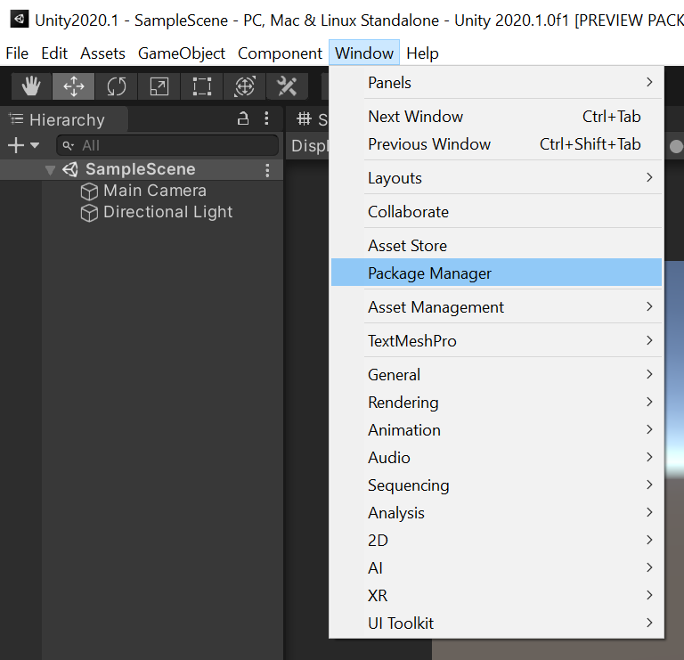
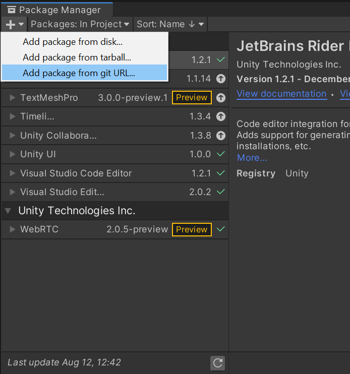
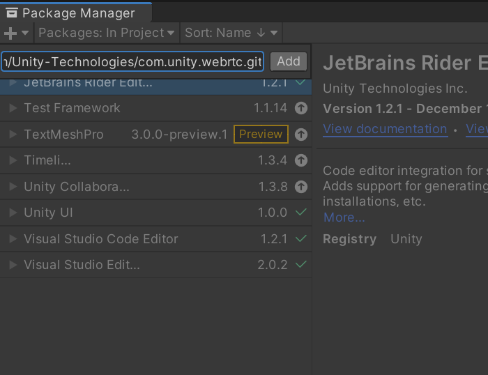

# Install package

Select `Window/Package Manager` in the menu bar.



Check Package Manager window, Click `+` button and select `Add package from git URL...`.



Input the string below to the input field.

```
https://github.com/FireDragonGameStudio/com.unity.webrtc.fdgs.git
```

To pin a specific version, append a tag, for example `https://github.com/FireDragonGameStudio/com.unity.webrtc.fdgs.git#v3.0.0`. The list of tags is [here](https://github.com/FireDragonGameStudio/com.unity.webrtc.fdgs/tags). In most cases, the latest version is recommended to use.



Click `Add` button, and will start install the package.

> [!NOTE]
> This package (`com.fdgs.webrtc`) is a fork of `com.unity.webrtc` and contains the same assemblies and namespace (`Unity.WebRTC`).
> Remove `com.unity.webrtc` from your project before installing it; the two packages cannot be installed side by side.
